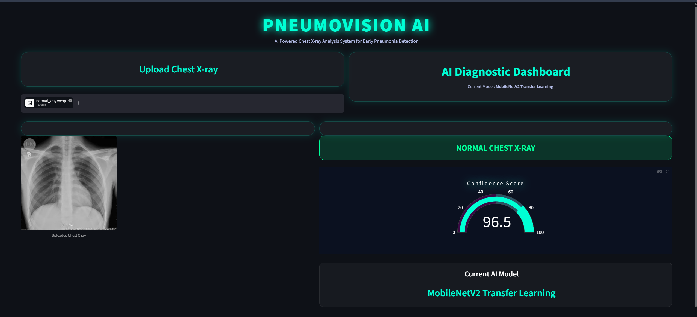
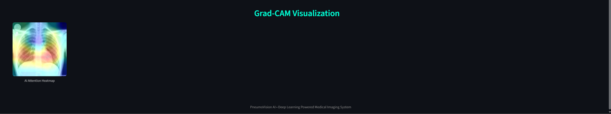

# PneumoVision AI

PneumoVision AI is an AI-powered pneumonia detection system built using Deep Learning and Transfer Learning techniques on Chest X-ray images.

The project uses TensorFlow, Keras, Streamlit, and MobileNetV2 to detect pneumonia from X-ray scans with high accuracy and interactive visualizations.

---

## Features

- Pneumonia detection from Chest X-ray images
- Basic CNN model implementation
- Transfer Learning using MobileNetV2
- Streamlit interactive dashboard
- Confidence score visualization
- Grad-CAM heatmap visualization
- Real-time image upload and prediction
- Model selection toggle
- Evaluation metrics and confusion matrix
- Modern AI-themed UI

---

## Tech Stack

- Python
- TensorFlow
- Keras
- OpenCV
- NumPy
- Matplotlib
- Streamlit
- Plotly
- MobileNetV2

---

## Models Used

### Basic CNN
Custom Convolutional Neural Network trained on Chest X-ray dataset.

### Transfer Learning
MobileNetV2 pretrained model fine-tuned for pneumonia detection.

---

## Dataset

Chest X-ray dataset containing:
- Normal X-ray images
- Pneumonia X-ray images

Dataset structure:
- Train
- Validation
- Test

---

## Performance

### Basic CNN
- Test Accuracy: ~82%

### Transfer Learning (MobileNetV2)
- Test Accuracy: ~90%
- Pneumonia Recall: ~95%

---

## Grad-CAM Visualization

Grad-CAM is used to visualize the regions of the X-ray image where the AI model focuses while making predictions.

---
## Screenshots

### Dashboard


### Prediction Result



### Grad-CAM Visualization




## Project Structure

```bash
PneumoVision-AI/
│
├── app/
│   └── streamlit_app.py
│
├── models/
│   ├── pneumovision_cnn_model.h5
│   └── pneumovision_transfer_model.h5
│
├── notebooks/
│   ├── pneumovision_cnn.ipynb
│   ├── transfer_learning_pneumovision.ipynb
│   └── xray_prediction_testing.ipynb
│
├── requirements.txt
├── README.md
└── .gitignore
